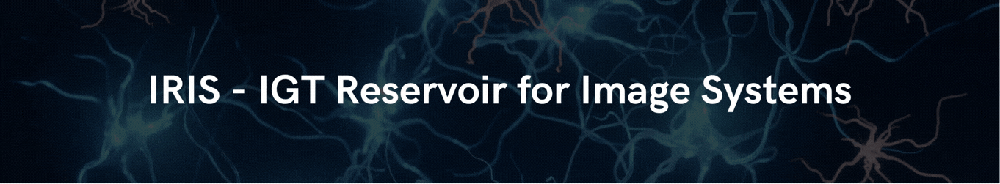

<!-- @format -->

<h1 align="center">
UMAP - <i>Uniform Manifold Approximation and Projection</i>
</h1>

  <i>Notebbok didático sobre o algorítimo de redução de dimensionalidade UMAP</i> 
  Ilum - School of Science | Campinas, 2026

  
  
  <!--  -->

<!--  -->

## Sobre o repositório

O objetivo desse repositório é apresentar de forma didática o algoritmo de redução de dimensionalidade UMAP, explicando os principais conceitos por trás de seu funcionamento e exemplos de como aplicá-lo.

---

## Conteúdos do repositório

O Repositório está organizado da seguinte forma:

<ul>
  <li> 📄 <b>README.md</b>: documento principal com a apresentação e orientações do projeto</li>

  <li> 📂 <b>notebooks</b>: contém os notebooks utilizados para apresentar e explorar o UMAP</li>
  <ul>
    <li> 📓 <b>00 - Visão Geral.ipynb</b>: introdução à redução de dimensionalidade e aos conceitos fundamentais do UMAP <b>(📌 comece aqui!)</b></li>
    <li> 📓 <b>01 - UMAP Detalhado.ipynb</b>: exploração detalhada do funcionamento e dos fundamentos matemáticos do UMAP</li>
    <li> 📓 <b>02 - Exemplos.ipynb</b>: aplicação do UMAP em diferentes conjuntos de dados e contextos</li>
  </ul>

  <li> 📂 <b>datasets</b>: contém os conjuntos de dados utilizados nos notebooks</li>
  <ul>
    <li> 📊 <b>brain_counts.csv</b>: dados de expressão gênica de células do cérebro de camundongo utilizados no exemplo de UMAP</li>
    <li> 📊 <b>word2vec.csv</b>: vetores de palavras utilizados no exemplo de UMAP aplicado a embeddings</li>
  </ul>

  <li> 📂 <b>assets</b>: contém recursos visuais utilizados ao longo do material</li>
</ul>

---

## Descrição do uso de IA neste trabalho

A maior parte da interação com ferramentas de Inteligência Artificial durante a construção desse trabalho se restringiu à uma conversa (Em alguns casos pontuais também se utilizou do resumo de IA durante pesquisas). Pedi para que o próprio chatbot resumisse como foi a interação:

> Durante o desenvolvimento deste trabalho, a Inteligência Artificial foi utilizada como ferramenta de apoio ao aprendizado, à programação e à organização do material. A interação ocorreu principalmente por meio de perguntas conceituais sobre redução de dimensionalidade, UMAP, Word2Vec, normalização de dados, PCA e análise de dados de expressão gênica, além de dúvidas sobre bibliotecas Python, pandas, Git e estruturação do repositório. As respostas foram utilizadas como apoio para compreender os conceitos, identificar possíveis problemas e comparar diferentes abordagens, enquanto as decisões sobre o desenvolvimento e a interpretação dos resultados foram realizadas ao longo do processo.
>
> Também foram solicitados códigos e trechos de código para tarefas específicas, como seleção de genes por variância, normalização de dados de RNA-seq, aplicação de PCA e UMAP, construção de gráficos e visualizações dos embeddings do Word2Vec e dos tipos celulares, além de operações de manipulação de DataFrames. Em vez de utilizar a IA apenas para obter respostas prontas, a interação foi feita de forma iterativa: os códigos eram testados, os resultados observados e novas perguntas eram feitas a partir dos problemas ou dúvidas encontrados durante a execução.

O link das principais conversas utilizadas estão aqui (novas conversas foram necessárias a medida que acaba a janela de contexto do modelo no plano gratuito)

- [Notebook Didático UMAP (1)](https://chatgpt.com/share/6ad589ae-bfac-83ea-ac00-6b27095b11cd)
- [Notebook Didático UMAP (2)](https://chatgpt.com/share/6ad589f5-56c0-83e8-b457-9c6863e086ee)
- [Notebook Didático UMAP (3)](https://chatgpt.com/share/6ad58a05-0920-83e9-a40d-55a3be1722c6)
- [Notebook Didático UMAP (4)](https://chatgpt.com/share/6ad58a10-b054-83e9-9100-993194ada779)
- [Notebook Didático UMAP (5)](https://chatgpt.com/share/6ad58a1c-d91c-83e8-a1c0-39f3851f5d81)

---

## Agradecimentos

Agradeço ao estagiário de estatística e computação João Vitor Pires de Souza por todo o auxilio e apoio oferecido durante o desenvolvemento do projeto. Também agradeço ao professor doutor Daniel Cassar por ter proporcionado a base teórica necessária para a compreensão adequada das técnicas apresentadas.

---

## Professor orientador

<table>
  <tr>
    <td align="center">
      <a href="https://github.com/drcassar">
         
        <b>Prof. Dr. Daniel R. Cassar</b>
      </a>
    </td>
  </tr>
</table>

---

## Autor

<table>
  <tr>
    <td align="center">
      <a href="https://github.com/FipaLipe">
         
        <b>Filipi Martins</b>
      </a>
    </td>
  </tr>
</table>
